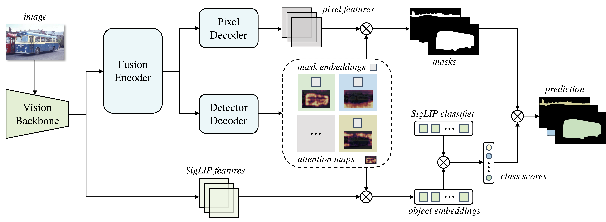

<h1>EOVSAM</h1>

<h3>Efficient Open-Vocabulary Segmentation with SAM 3 in One Pass</h3>

Haomin Peng1, Yongkang Li1, Zhaoxiang Liu2,3, Xiaojie Jin4, Shiguo Lian2,3, Yunchao Wei4, Xinggang Wang1📧 
1 Huazhong University of Science and Technology 
2 Data Science &amp; Artificial Intelligence Research Institute, China Unicom 
3 Unicom Data Intelligence, China Unicom 
4 Beijing Jiaotong University 
(📧 corresponding author)

EOVSAM implements an efficient open-vocabulary segmentation framework built on SAM 3. The repository also provides an implementation that applies SAM 3 to open-vocabulary segmentation.

  

## Abstract

Open-vocabulary segmentation identifies and segments objects from arbitrary textual descriptions. SAM 3 supports noun-phrase-guided segmentation and achieves competitive open-vocabulary performance through exhaustive vocabulary traversal, yet suffers from prohibitive computational overhead as target categories scale. In this paper, we propose an Efficient Open-Vocabulary Segmentation framework with SAM 3 (EOVSAM), which adapts SAM 3 for single-pass prediction. EOVSAM removes prompt conditioning to turn SAM 3 into an efficient mask generator and introduces a new Attentional Aggregation strategy to optimize open-vocabulary classification end-to-end. This formulation avoids the multi-stage pipelines and post-processing heuristics commonly used by existing methods, while mitigating the closed-set collapse that can arise when classification is optimized directly. EOVSAM consistently improves segmentation accuracy over vanilla SAM 3 on all evaluated datasets and accelerates inference by up to 338x. Furthermore, EOVSAM maintains high accuracy at lower resolutions while achieving even more remarkable inference speeds. Experiments on standard semantic and panoptic segmentation benchmarks show that EOVSAM combines competitive or state-of-the-art accuracy with a substantial speed advantage over existing open-vocabulary segmentation models.

## Models

| Model | A-847 | A-150 | PC-459 | PC-59 | PAS-20 | ADE20K PQ | Download |
| --- | ---: | ---: | ---: | ---: | ---: | ---: | --- |
| EOVSAM | 16.6 | 39.0 | 20.4 | 60.9 | 97.0 | 30.9 | [eovsam](https://huggingface.co/HaominPeng/EOVSAM/resolve/main/eovsam.pth) |
| SAM 3 | 14.0 | 37.8 | 18.3 | 58.3 | 96.3 | - | [sam3](https://huggingface.co/facebook/sam3/resolve/main/sam3.pt?download=true) |

## Installation

Use a single Conda environment named eovsam for EOVSAM and SAM 3 open-vocabulary segmentation.

~~~
conda create -n eovsam python=3.10 -y
conda activate eovsam
pip install --upgrade pip setuptools wheel
pip install torch==2.5.1 torchvision==0.20.1 torchaudio==2.5.1 --index-url https://download.pytorch.org/whl/cu124
pip install --no-build-isolation 'git+https://github.com/facebookresearch/detectron2.git@v0.6'
pip install -r requirements.txt
~~~

The reference environment uses Python 3.10.18, PyTorch 2.5.1, CUDA 12.4, and Detectron2 0.6.

## Dataset Preparation

Set DETECTRON2_DATASETS to the dataset root.

See **[Prepare Datasets for EOVSAM](datasets/README.md)** for the required COCO, ADE20K, PASCAL VOC, and PASCAL Context directory layouts, download sources, and preprocessing commands.

## Usage

### EOVSAM

Train the paper configuration on two GPUs:

~~~
conda activate eovsam
python train_net.py --num-gpus 2 --config-file configs/train.yaml OUTPUT_DIR output/eovsam_train MODEL.WEIGHTS weights/sam3.pt
~~~

Evaluate a trained checkpoint:

~~~
python train_net.py --num-gpus 1 --eval-only --config-file configs/eval_semantic.yaml OUTPUT_DIR output/eovsam_semantic MODEL.WEIGHTS weights/eovsam.pth
python train_net.py --num-gpus 1 --eval-only --config-file configs/eval_panoptic.yaml OUTPUT_DIR output/eovsam_panoptic MODEL.WEIGHTS weights/eovsam.pth
~~~

### SAM 3 Open-Vocabulary Segmentation

~~~
conda activate eovsam
python SAM3OVS/train_net.py --num-gpus 1 --eval-only --config-file SAM3OVS/configs/sam3.yaml OUTPUT_DIR output/sam3_ade20k MODEL.WEIGHTS weights/sam3.pt
~~~

## License

This is a composite distribution. EOVSAM incorporates NVIDIA RADIO, SAM 3, and MAFT-Plus components; each remains subject to its upstream terms.

- NVIDIA RADIO code under NVlabs/RADIO/ is covered by the included NVIDIA Source Code License for RADIO. Its use is limited to non-commercial research or evaluation.
- SAM 3 code and the official sam3.pt checkpoint are covered by the [SAM License](licenses/SAM_LICENSE). Redistribution must include that agreement and comply with its use restrictions.
- MAFT-Plus-derived code is covered by the [MIT License](licenses/MAFT_PLUS_MIT_LICENSE).

No broader license is granted for the complete repository. Retain all source-file notices and upstream licenses when redistributing.

## Acknowledgement

This project is built upon [NVIDIA RADIO](https://github.com/NVlabs/RADIO), [SAM 3](https://github.com/facebookresearch/sam3), [MAFT-Plus](https://github.com/jiaosiyu1999/MAFT-Plus), [Detectron2](https://github.com/facebookresearch/detectron2), [Mask2Former](https://github.com/facebookresearch/Mask2Former), [FC-CLIP](https://github.com/bytedance/fc-clip), and [MaskAdapter](https://github.com/hustvl/MaskAdapter). We thank their authors for releasing their code and models.

## Citation

If you find EOVSAM useful, please cite:

~~~
@misc{peng2026eovsamefficientopenvocabularysegmentation,
      title={EOVSAM: Efficient Open-Vocabulary Segmentation with SAM 3 in One Pass}, 
      author={Haomin Peng and Yongkang Li and Zhaoxiang Liu and Xiaojie Jin and Shiguo Lian and Yunchao Wei and Xinggang Wang},
      year={2026},
      eprint={2608.02284},
      archivePrefix={arXiv},
      primaryClass={cs.CV},
      url={https://arxiv.org/abs/2608.02284}, 
}
~~~
